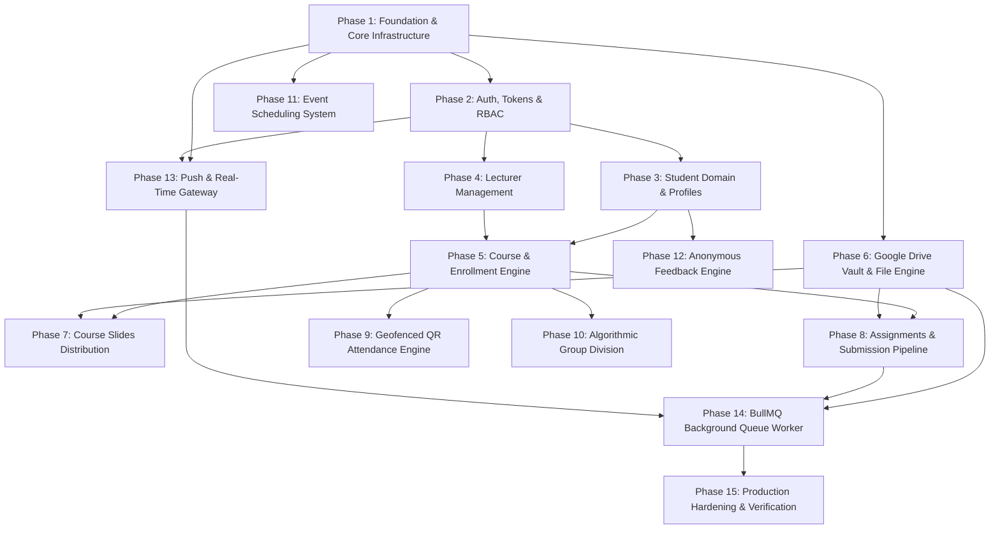

# Course Rep Management System — v2 Backend Architecture & Phased Migration Plan

## Goal Description
The objective of this project is to execute a complete architectural transformation of the Course Rep Management System backend from a JavaScript/Express/Sequelize monolithic service into an enterprise-grade, high-performance, and secure **NestJS** application written in **TypeScript** utilizing **TypeORM** and **PostgreSQL**. 

The v1 codebase possesses critical architectural vulnerabilities, including privilege escalation bugs, Insecure Direct Object References (IDOR), unhashed secrets and tokens, race conditions in Redis caching, and lack of transaction safety. 

This plan details a comprehensive audit of the v1 system followed by **15 sequential, feature-by-feature phases**. Each phase corresponds to exactly **one complete business feature**, further divided into granular sub-phases covering every model, repository, service, DTO, guard, worker, and controller needed to achieve complete parity without breaking the application's core educational mission.

---

## Comprehensive Codebase Audit Findings (v1)

### 1. Critical Security Vulnerabilities
* **Privilege Escalation via Mass Assignment (`student.Controller.js` L163-165)**: `updateStudent` accepts `isRep` directly from `req.body` without role checks. Any authenticated student can promote themselves to Course Representative with full administrative privileges.
* **Insecure Direct Object Reference (IDOR) in Password Change (`auth.Controller.js` L198)**: `changePassword` consumes `student_id` directly from `req.body` with zero token identity checks and no `authenticate` middleware on `/api/auth/change`.
* **IDOR in Assignment Submissions (`assignment.Controller.js` L303)**: `deleteSubmittedAssignment` and `getStudentSubmittedAssignments` accept `studentId` from parameters rather than the authenticated session, allowing malicious students to view or delete peers' submissions.
* **IDOR in Anonymous Feedback (`feedback.Controller.js` L10-18)**: `sendFeedback` takes `studentId` from `req.body`, allowing impersonation. Furthermore, `is_anonymous: true` retains the `studentId` in the database, breaking true anonymity guarantees.
* **Google Drive Unrestricted Access (`google.Controller.js`)**: Folder creation, file upload, and file deletion endpoints lack the `authorize` guard, enabling any authenticated student to manipulate root Google Drive assets.
* **Unauthenticated Push Notification Token Injection (`notification.Route.js` L17)**: `/api/notifications/push` lacks authentication, permitting unauthorized actors to harvest or poison FCM device tokens.
* **Secrets Exposed in Plaintext in Database**:
  * `GoogleToken`: `client_secret`, `access_token`, and `refresh_token` stored without encryption at rest.
  * `RefreshToken`: Plaintext tokens stored in Postgres; a database leak immediately compromises active user sessions.
  * `Verification`: Password reset tokens stored in plaintext without cryptographic hashing.
  * `AttendanceInstance`: Plaintext `qr_token` stored in the database.
* **XSS Vectors in Email Dispatchers (`customEmails.js`)**: `sendMessageToStudent` and `sendGroupAssignmentEmail` inject user strings directly into HTML templates without sanitization.
* **SMS API Key Leakage (`sendSMS.js`)**: Arkesel API key is transmitted via GET query parameters, exposing secrets across HTTP logs, reverse proxies, and browser caches.

### 2. Concurrency, Race Conditions & Performance Issues
* **Module-Level Variable Mutex Corruption (`student.Controller.js` L7, `lecturer.Controller.js` L7, etc.)**: Controllers use module-scoped `let redisKey = ...` mutated on request processing. Under concurrent requests, cache operations cross-contaminate and invalidate unintended cache keys.
* **Missing Pagination & Unbounded Memory Consumption**:
  * `getAllLecturer`, `getAllCourse`, `getAllEvent` execute unconstrained `findAll()` queries.
  * `markAllAsRead` loads all notifications in the system into memory before mass-inserting read receipts.
* **Database Deadlocks & Missing Transactions**: Multi-table operations (such as deleting courses and associated Google Drive assets, or cascading instance deletions) run sequentially without database transactions (`QueryRunner` / transaction manager).
* **Synchronous Event Loop Blocking**: `cleanUpFile.js` relies on `fs.unlinkSync`, blocking the Node.js event loop during heavy file processing.

### 3. Schema & Data Integrity Bugs
* **`Lecturer.id` Generation Bug (`Lecturer.js` L8-10)**: `defaultValue: DataTypes.UUID` assigns the Sequelize class object rather than invoking `DataTypes.UUIDV4`, causing runtime crashes on record creation without manual IDs.
* **`GroupMember.groupId` Foreign Key Bug (`GroupMember.js` L8-10)**: Sets `defaultValue: DataTypes.UUIDV4` on a foreign key column.
* **`Slides` Dual Primary Key Bug (`Slides.js` L7-12)**: Both `id` and `driveFileID` are flagged as `primaryKey: true`, generating an inadvertent composite primary key.
* **Coordinate Precision Loss (`AttendanceInstance.js` L17-18)**: Coordinates stored as standard `FLOAT`, truncating GPS decimal precision required for geofencing.
* **Schema Drift Hazard (`index.js` L24)**: `sequelize.sync({ alter: true })` runs at application boot, creating table locks and schema corruption in production.

---

## User Review Required

> [!IMPORTANT]
> **Database Schema Migration & Password Compatibility**: 
> v2 will migrate all database schema definitions to TypeORM entities managed strictly via versioned migration scripts. Passwords currently hashed using `bcrypt` will remain compatible; existing password hashes will be verified seamlessly via `bcrypt` in the new NestJS Auth module.

> [!WARNING]
> **Session & Token Format Transition**: 
> Refresh tokens will now be cryptographically hashed (SHA-256) prior to database persistence. Upon deployment of v2, existing refresh tokens in the database will be invalidated, requiring users to log in once to establish secure hashed refresh token pairs.

> [!CAUTION]
> **Strict API Authorization & Breaking Fixes**: 
> Unauthenticated or misconfigured routes in v1 (such as `/api/auth/change` without auth, or student endpoints accepting arbitrary `studentId` parameters) will strictly enforce JWT identity (`req.user.id`). Frontend calls passing spoofed IDs will now receive `403 Forbidden`.

---

## Open Questions

> [!IMPORTANT]
> 1. **True Anonymity vs Pseudonymity in Feedback**: 
> In v1, `feedback` stored `studentId` even when `is_anonymous` was true, simply scrubbing it upon API serialization. Do you prefer v2 to completely decouple `studentId` (set to `NULL` on write for anonymous submissions) to guarantee cryptographic anonymity, or maintain an audit trail accessible only by system administrators?
> *(Recommended: Set `studentId` to `NULL` for true anonymity).*
>
> 2. **Repository vs QueryBuilder in TypeORM**: 
> Should standard CRUD operations use TypeORM's declarative `Repository` patterns while complex aggregations (such as attendance geofencing queries, notification read states, and group division) use `EntityManager` / `QueryBuilder`?
> *(Recommended: Hybrid approach for maximum type safety and query performance).*

---

## Proposed Phased Implementation Architecture



---

### Phase 1: Project Scaffold, Core Infrastructure & Database Engine
**Feature Purpose**: Establish an enterprise NestJS TypeScript workspace with modular architecture, strict TypeORM persistence, non-blocking Redis management, and global operational resilience.

#### Sub-phase 1.1: NestJS & TypeScript Workspace Configuration
* Initialize NestJS application with TypeScript 5.x, ESLint, Prettier, and path aliases (`@core/*`, `@modules/*`, `@common/*`).
* Configure `nest-cli.json` and strict `tsconfig.json` (`strict: true`, `noImplicitAny: true`, `strictNullChecks: true`).
* Structure directory hierarchy:
  ```
  src/
  ├── common/        # Decorators, filters, guards, interceptors, pipes
  ├── config/        # Environment validation & configuration factories
  ├── database/      # Data-source, migrations, naming strategies
  ├── modules/       # Feature modules
  └── main.ts        # Bootstrap entrypoint
  ```

#### Sub-phase 1.2: TypeORM Data Source, PostgreSQL & Migrations Framework
* Configure `TypeOrmModule.forRootAsync` utilizing `@nestjs/config` and `pg`.
* Enforce SnakeNamingStrategy for strict PostgreSQL identifier consistency (`student_id`, `course_id`).
* Implement discrete TypeORM `DataSource` configuration for CLI migration generation and execution (`npm run migration:generate`, `npm run migration:run`).
* Eliminate `sync: true` and `alter: true`; all schema mutations handled via version-controlled migrations.

#### Sub-phase 1.3: Redis & Distributed Cache-Manager Module
* Implement `RedisModule` wrapping `ioredis` with automatic reconnection, health checks, and exponential backoff.
* Build a `CacheService` providing isolated keyspacing (e.g., `cr:students:`, `cr:courses:`) preventing key collisions.
* Create a non-blocking `scanAndInvalidate` utility leveraging Redis `SCAN` + `UNLINK` pipelines instead of blocking `KEYS` / `DEL`.

#### Sub-phase 1.4: Global Interceptors, Pipes & Exception Filters
* Implement `HttpExceptionFilter` ensuring unified, safe error responses matching RFC 7807 (`{ success: false, statusCode, message, timestamp, path }`).
* Implement `TransformResponseInterceptor` unifying success payloads (`{ success: true, message, data, meta }`).
* Implement `ValidationPipe` with `class-validator` and `class-transformer` (`whitelist: true`, `forbidNonWhitelisted: true`, `transform: true`).
* Implement `LoggingInterceptor` powered by `Winston` with structured JSON output and request tracing.

#### Sub-phase 1.5: Secure Configuration & Secrets Management
* Implement `@nestjs/config` with Joi validation schema validating all environment variables at startup (`DB_*`, `JWT_*`, `REDIS_*`, `SMTP_*`, `GOOGLE_*`).
* Move all secrets away from committed source files into `.env.example` templates and secret managers.

---

### Phase 2: Authentication, Session & Token Security Feature
**Feature Purpose**: Provide high-security, JWT-based authentication with cryptographically hashed refresh tokens, robust password recovery lifecycles, and role-based access control without IDOR vulnerabilities.

#### Sub-phase 2.1: Student Auth Entities & Hashed Token Storage
* Create `Student` entity (decorated with TypeORM `@Entity('students')`) containing:
  * `id`: `varchar(50)` Primary Key.
  * `email`: `varchar(255)`, `unique: true`, indexed.
  * `passwordHash`: `varchar(255)`, excluded from default query selections (`select: false`).
  * `isRep`: `boolean`, default `false`.
  * `status`: `enum` (`ACTIVE`, `SUSPENDED`, `PENDING`), default `ACTIVE`.
* Create `RefreshToken` entity:
  * `id`: `uuid`, Primary Key.
  * `studentId`: Foreign Key to `Student` with `onDelete: CASCADE`.
  * `tokenHash`: `varchar(255)` (storing SHA-256 hash of refresh token; no plaintext tokens).
  * `expiresAt`: `timestamp with time zone`.
  * `revokedAt`: `timestamp with time zone`, nullable.
* Create `PasswordReset` entity:
  * `studentId`: Foreign Key to `Student`.
  * `tokenHash`: SHA-256 hashed one-time token.
  * `expiresAt`: `timestamp with time zone` (strict 15-minute TTL).

#### Sub-phase 2.2: JWT Strategy, Guards & Role-Based Access Control (RBAC)
* Implement `JwtStrategy` using `passport-jwt` verifying access tokens (15-minute lifetime) from `Authorization: Bearer <token>`.
* Build `@CurrentUser()` custom parameter decorator extracting validated student context.
* Implement `@Roles('REP', 'STUDENT')` metadata decorator and `RolesGuard`.
* Build `JwtAuthGuard` with optional anonymous bypass via custom `@Public()` decorator.

#### Sub-phase 2.3: Secure Login, Token Rotation & Revocation
* Implement `AuthService.login()`:
  * Constant-time comparison using `bcrypt` preventing username enumeration timing attacks.
  * Generate cryptographically random refresh token (64 bytes hex), store SHA-256 hash in database.
  * Issue signed JWT access token containing `{ sub: student.id, email: student.email, isRep: student.isRep }`.
  * Set secure, `httpOnly`, `sameSite: strict`, `secure: true` cookie for the refresh token.
* Implement `AuthService.refreshToken()`:
  * Validate and rotate refresh token: revoke existing token record and issue a fresh pair (preventing replay attacks).
* Implement `AuthService.logout()`:
  * Explicitly revoke refresh token in database and clear client cookie across path `/`.

#### Sub-phase 2.4: Password Reset Lifecycle
* Implement `AuthService.forgotPassword()`:
  * Always return generic 200 response to prevent email harvesting.
  * If student exists, generate secure crypto token, hash and persist in `PasswordReset`, and queue transactional reset email via BullMQ.
* Implement `AuthService.resetPassword()`:
  * Verify token hash and expiration in a database transaction, hash new password (bcrypt work factor 12), update `Student`, invalidate all active `RefreshToken` sessions.

#### Sub-phase 2.5: Secure Self-Password Management (IDOR Elimination)
* Implement `AuthService.changePassword()`:
  * Apply `JwtAuthGuard` to `/api/auth/change`.
  * Extract `studentId` strictly from `@CurrentUser('id')`, rejecting any body parameter attempts to manipulate foreign accounts.
  * Verify current password before committing new password.

---

### Phase 3: Student Management & Profile Feature
**Feature Purpose**: Handle student registration, self-service profile management, and Course Rep administrative operations with comprehensive ownership protection and sanitized responses.

#### Sub-phase 3.1: Student DTOs & Validation Contracts
* Create `RegisterStudentDto`:
  * Validates university student ID format, corporate/academic email format, strong password criteria, phone format.
  * Prohibits `isRep` field injection via `ValidationPipe` whitelist.
* Create `UpdateStudentProfileDto`:
  * Allows updating `name`, `phone`.
  * Strictly forbids updating `id`, `email`, `isRep`, or `status`.
* Create `AdminUpdateStudentDto`:
  * Accessible only by verified Course Reps to manage student statuses or assign Rep designations.

#### Sub-phase 3.2: Secure Student Registration Pipeline
* Implement `StudentService.register()`:
  * Check for duplicate ID and email using transactional read locks.
  * Hash password and persist `Student` with `isRep: false`.
  * Dispatch welcome email asynchronously via `EmailQueueProducer`.
  * Invalidate student directory cache via non-blocking Redis SCAN.

#### Sub-phase 3.3: Student Profile Read/Update with Strict Ownership Guard
* Implement `StudentOwnershipGuard`:
  * Ensures that non-Rep students can only access or modify `/api/students/:id` where `:id === req.user.id`.
* Implement `StudentService.getProfile()`:
  * Returns student profile with registered courses and group affiliations.
  * Guarantees `passwordHash` is never serialized.
* Implement `StudentService.updateProfile()`:
  * Executes profile updates using validated DTO.

#### Sub-phase 3.4: Administrative Student Operations & Paginated Caching
* Implement `StudentService.findAllPaginated()`:
  * Supports cursor/offset pagination (`page`, `limit`), search query (`search`), and status filters.
  * Integrates with `CacheService` using dynamic keys (`cr:students:page=${page}:limit=${limit}:query=${search}`).
* Implement `StudentService.deleteStudent()`:
  * Course Rep only; wraps deletion in a transaction to safely decouple associations.

---

### Phase 4: Lecturer Management Feature
**Feature Purpose**: Provide an administrative CRUD domain for faculty members with proper primary key auto-generation, course associations, and query optimization.

#### Sub-phase 4.1: Lecturer Entity & Relational Schema Fixes
* Create `Lecturer` entity:
  * `id`: `uuid`, Primary Key with `@PrimaryGeneratedColumn('uuid')` (fixing v1 `DataTypes.UUID` class bug).
  * `name`: `varchar(255)`, not nullable.
  * `email`: `varchar(255)`, unique, indexed.
  * `phone`: `varchar(50)`, nullable.
  * `courses`: `@OneToMany(() => Course, course => course.lecturer)`.
  * Timestamps: `created_at`, `updated_at`.

#### Sub-phase 4.2: Lecturer DTOs & Validation
* Create `CreateLecturerDto` and `UpdateLecturerDto` validating email format, full name, and phone standards.

#### Sub-phase 4.3: Lecturer Service & Paginated Caching
* Implement `LecturerService`:
  * `findAll(query)`: Add pagination (`page`, `limit`), resolving v1 unbounded query issues.
  * `findById(id)`: Fetch lecturer along with assigned courses.
  * `create()`, `update()`, `delete()`: Wrapped with cache invalidation for `cr:lecturers:*`.

#### Sub-phase 4.4: Lecturer Controller & Authorization
* Apply `JwtAuthGuard` globally across all endpoints.
* Protect `POST`, `PUT`, `DELETE` behind `@Roles('REP')` and `RolesGuard`.
* Allow read operations (`GET`) for all verified students.

---

### Phase 5: Course Management & Student Enrollment Feature
**Feature Purpose**: Manage academic courses, schedule constraints, lecturer assignments, and transactional student self-enrollment without race conditions.

#### Sub-phase 5.1: Course & CourseStudent Relational Entities
* Create `Course` entity:
  * `id`: `varchar(50)` Primary Key (e.g., "CPEN401").
  * `name`: `varchar(255)`, not nullable.
  * `lecturerId`: `uuid`, Foreign Key to `Lecturer` (`onDelete: SET NULL` to preserve course history if a lecturer leaves).
  * `dayOfWeek`: `enum` (`MONDAY`, `TUESDAY`, `WEDNESDAY`, `THURSDAY`, `FRIDAY`, `SATURDAY`, `SUNDAY`).
  * `startTime`: `time`, not nullable.
  * `endTime`: `time`, not nullable.
  * `semester`: `varchar(50)`, not nullable.
  * `slidesFolderId`: `varchar(255)`, nullable (Google Drive reference).
* Create `CourseStudent` join entity:
  * Composite PK: `courseId` + `studentId`.
  * `isRegistered`: `boolean`, default `true`.
  * `registeredAt`: `timestamp with time zone`, default `CURRENT_TIMESTAMP`.
  * Foreign keys configured with explicit `onDelete: CASCADE`.

#### Sub-phase 5.2: Course Validation & DTO Specifications
* Create `CreateCourseDto` and `UpdateCourseDto`:
  * Enforce valid time ranges (`startTime < endTime`), valid semester labels, and existing `lecturerId`.
* Create `RegisterCourseDto`:
  * Prevents arbitrary `studentId` injection; `studentId` derived exclusively from authenticated session.

#### Sub-phase 5.3: Course Enrollment Engine with Transaction Safety
* Implement `CourseService.registerStudent()`:
  * Executes inside a database transaction (`EntityManager.transaction`).
  * Uses `SELECT ... FOR UPDATE` or upsert semantics to prevent concurrent duplicate enrollment race conditions.
  * Invalidates specific student course caches.
* Implement `CourseService.deregisterStudent()`:
  * Safely removes enrollment without affecting attendance records.

#### Sub-phase 5.4: Course Queries & Google Drive Provisioning Hook
* Implement `CourseService.createCourse()`:
  * Persists course and dispatches an asynchronous background job to create the course's Google Drive slides folder.
* Implement `CourseService.findAllCourses()` and `getStudentCourses()`:
  * Structured pagination and eager relations loading without N+1 query penalties.

---

### Phase 6: Google Drive Integration & File Engine Feature
**Feature Purpose**: Provide an enterprise cloud storage bridge supporting encrypted OAuth2 credentials, resilient folder structures, and streaming file operations resistant to query injection.

#### Sub-phase 6.1: Encrypted OAuth2 Token Vault Entity & Service
* Create `GoogleCredential` entity:
  * `id`: `varchar(50)` Primary Key (`USER_ID`).
  * `clientId`: `varchar(255)`, not nullable.
  * `clientSecretEncrypted`: `text`, encrypted at rest using AES-256-GCM.
  * `refreshTokenEncrypted`: `text`, encrypted at rest.
  * `accessTokenEncrypted`: `text`, nullable, encrypted.
  * `expiryDate`: `bigint`, nullable.
* Implement `EncryptionService`:
  * AES-256-GCM symmetric encryption/decryption with initialization vectors (IV) and auth tags.
* Implement `GoogleAuthService`:
  * Automatic refresh token negotiation and key rotation.
  * Secure storage and decryption on the fly.

#### Sub-phase 6.2: Resilient Google Drive Core Service
* Implement `GoogleDriveService`:
  * `createFolder(folderName, parentFolderId?)`: Safe folder creation with parent linkage.
  * `searchFolder(folderName, parentFolderId?)`: Escapes single quotes and control characters to prevent Drive Query Injection (`q: name = '${escaped}'`).
  * `deleteFile(fileId)`: Idempotent file/folder deletion with error handling.

#### Sub-phase 6.3: Streaming File Upload & Download Engine
* Implement `GoogleDriveService.uploadStream(fileStream, metadata)`:
  * Pipes multipart form streams directly to Google Drive API without storing oversized temporary files on disk.
* Implement `GoogleDriveService.downloadStream(fileId)`:
  * Streams file chunks directly to client HTTP response with sanitized `Content-Disposition` headers preventing HTTP Header Injection.

#### Sub-phase 6.4: Controller Hardening & RBAC
* Apply strict `@Roles('REP')` guard across administrative folder management and file deletion endpoints.
* Restrict general student access to read/download authenticated assets only.

---

### Phase 7: Course Slides & Material Distribution Feature
**Feature Purpose**: Enable Course Reps to distribute lecture notes and slides with automatic Google Drive synchronization, deduplication, and cached student access.

#### Sub-phase 7.1: Slide Entity & Normalized Schema
* Create `Slide` entity:
  * `id`: `uuid`, Primary Key with `@PrimaryGeneratedColumn('uuid')` (resolves v1 composite PK bug).
  * `driveFileId`: `varchar(255)`, `unique: true`, indexed.
  * `courseId`: Foreign Key to `Course` (`onDelete: CASCADE`).
  * `fileName`: `varchar(255)`, not nullable.
  * `fileSize`: `bigint`, nullable.
  * `mimeType`: `varchar(100)`, nullable.
  * `fileHash`: `varchar(64)`, nullable (SHA-256 for duplicate detection).
  * Timestamps: `created_at`, `updated_at`.

#### Sub-phase 7.2: Multi-File Upload Pipeline & Validation
* Implement `Fastify` / `Express` Multer interceptor:
  * Restrict maximum file upload size to a reasonable threshold (e.g., 50MB per file, configurable via environment).
  * Strict MIME-type allowlist (PDF, PPTX, PPT, DOCX, ZIP).
  * Rejection of executable extensions (.exe, .sh, .bat, .js).

#### Sub-phase 7.3: Slide Service & Background Cloud Sync
* Implement `SlideService.uploadSlides()`:
  * Calculates file hash to detect duplicates.
  * Enqueues upload jobs to BullMQ `SlideUploadProcessor`.
  * Emits real-time progress via WebSocket gateway.
* Implement `SlideService.deleteSlide()`:
  * Transactionally deletes database record and enqueues Google Drive file purge.

#### Sub-phase 7.4: Slide Queries, Permissions & Caching
* Implement `SlideService.getSlidesByCourse()`:
  * Cached in Redis with automatic invalidation upon new slide upload or deletion.
  * Verifies requesting student is enrolled in the target course.

---

### Phase 8: Assignment Management & Submission Feature
**Feature Purpose**: Deliver a complete assignment lifecycle containing deadline validation, Google Drive submission folder segregation, and IDOR-free student submissions.

#### Sub-phase 8.1: Assignment & Submission Entities
* Create `Assignment` entity:
  * `id`: `uuid`, Primary Key.
  * `title`: `varchar(255)`, not nullable.
  * `description`: `text`, nullable (fixing v1 255-character string limitation).
  * `courseId`: Foreign Key to `Course` (`onDelete: CASCADE`).
  * `deadline`: `timestamp with time zone`, not nullable, indexed.
  * `driveFolderId`: `varchar(255)`, not nullable (Google Drive folder for submissions).
  * `driveAttachmentFileId`: `varchar(255)`, nullable (course rep attachment).
  * `fileName`: `varchar(255)`, nullable.
* Create `AssignmentSubmission` entity:
  * `id`: `uuid`, Primary Key.
  * `assignmentId`: Foreign Key to `Assignment` (`onDelete: CASCADE`).
  * `studentId`: Foreign Key to `Student` (`onDelete: CASCADE`).
  * `driveFileId`: `varchar(255)`, not nullable.
  * `fileName`: `varchar(255)`, not nullable.
  * `submittedAt`: `timestamp with time zone`, default `CURRENT_TIMESTAMP`.
  * Unique constraint on `[assignmentId, studentId]` (enforces single submission or deliberate resubmission).

#### Sub-phase 8.2: Assignment Creation & Submission Folder Provisioning
* Implement `AssignmentService.createAssignment()`:
  * Requires `@Roles('REP')`.
  * Creates assignment entity.
  * Provisions a dedicated sub-folder in Google Drive (`"Assignments - {courseCode} - {assignmentTitle}"`).
  * Dispatches course-wide notification to enrolled students.

#### Sub-phase 8.3: Student Submission Pipeline with Deadline Enforcement
* Implement `AssignmentService.submitAssignment()`:
  * Verifies deadline: `if (new Date() > assignment.deadline) throw new ForbiddenException("Deadline passed")`.
  * Uploads submission to the assignment's designated Google Drive folder.
  * Derives `studentId` strictly from authenticated session token.
  * If previous submission exists, deletes old Google Drive file and updates record in a transaction.

#### Sub-phase 8.4: Submission Queries & Deletion Protection (IDOR Elimination)
* Implement `AssignmentService.deleteSubmission()`:
  * Requires ownership: requesting student must match `submission.studentId` OR have `@Roles('REP')`.
  * Removes file from Drive and deletes database record safely.
* Implement `AssignmentService.getSubmissionsForStudent()`:
  * Only permits students to view their own submissions. Course Reps can view all submissions for an assignment.

---

### Phase 9: Attendance Management & Geofenced QR Verification Feature
**Feature Purpose**: High-performance attendance session tracking with geofenced location verification (Haversine formula), tamper-proof QR tokens, and duplicate-marking prevention.

#### Sub-phase 9.1: Attendance Entities & Schema Integrity
* Create `AttendanceInstance` entity:
  * `id`: `uuid`, Primary Key.
  * `courseId`: Foreign Key to `Course` (`onDelete: CASCADE`).
  * `sessionDate`: `date`, not nullable.
  * `classType`: `enum` (`IN_PERSON`, `ONLINE`), not nullable.
  * `latitude`: `decimal(10, 8)`, nullable (precise GPS coordinate).
  * `longitude`: `decimal(11, 8)`, nullable (precise GPS coordinate).
  * `radiusMeters`: `integer`, default 50 (configurable geofence boundary).
  * `qrSecretHash`: `varchar(255)`, not nullable (HMAC key for signed QR tokens).
  * `expiresAt`: `timestamp with time zone`, not nullable.
  * `isClosed`: `boolean`, default `false`, indexed.
* Create `AttendanceRecord` entity:
  * `id`: `uuid`, Primary Key.
  * `instanceId`: Foreign Key to `AttendanceInstance` (`onDelete: CASCADE`).
  * `studentId`: Foreign Key to `Student` (`onDelete: CASCADE`).
  * `status`: `enum` (`PRESENT`, `ABSENT`, `EXCUSED`), default `PRESENT`.
  * `markedAt`: `timestamp with time zone`, default `CURRENT_TIMESTAMP`.
  * `ipAddress`: `varchar(45)`, nullable.
  * Unique constraint on `[instanceId, studentId]` (prevents double-marking).
* Create `AttendanceAuditLog` entity:
  * Tracks geolocation discrepancies, device hashes, and rejected check-in attempts.

#### Sub-phase 9.2: Cryptographic QR Code Generation Engine
* Implement `AttendanceService.initializeSession()`:
  * Generates session secret and produces a digitally signed time-bounded token: `JWT.sign({ instanceId, courseId, nonce }, secret, { expiresIn: '60s' })`.
  * Generates dynamic SVG / Data-URL QR code stream for Rep projection.
  * Emits rotating QR codes over WebSocket to prevent token capture/sharing.

#### Sub-phase 9.3: Geofence Verification Engine (Haversine Algorithm)
* Implement `GeolocationService.verifyCoordinates()`:
  * Validates in-person coordinates using the Haversine great-circle distance formula.
  * If distance between student GPS and class GPS exceeds `radiusMeters`, records audit log and rejects check-in.

#### Sub-phase 9.4: High-Throughput Check-In & Replay Protection
* Implement `AttendanceService.markAttendance()`:
  * Checks Redis key `attendance:lock:{instanceId}:{studentId}` via `SET NX EX 10` to eliminate double-submit race conditions.
  * Verifies QR signature, expiration, and session active status.
  * Inserts `AttendanceRecord` with `ON CONFLICT DO NOTHING`.
  * Broadcasts live attendee counter updates to Course Rep dashboard via WebSocket.

#### Sub-phase 9.5: Attendance Analytics, Closures & Export
* Implement `AttendanceService.closeSession()`:
  * Closes session, sets `isClosed: true`, and purges cached verification tokens.
* Implement `AttendanceService.generateReport()`:
  * Aggregates attendance metrics per student/course, exports CSV/Excel streams.

---

### Phase 10: Group Management & Automated Division Feature
**Feature Purpose**: Facilitate academic group formations with automated randomized or constraint-based distribution algorithms, leader appointments, and course enrollment validation.

#### Sub-phase 10.1: Group & GroupMember Entities
* Create `Group` entity:
  * `id`: `uuid`, Primary Key.
  * `name`: `varchar(100)`, not nullable.
  * `courseId`: Foreign Key to `Course`, nullable (nullable = general cohort group).
  * `description`: `varchar(255)`, nullable.
* Create `GroupMember` entity:
  * Composite PK: `groupId` + `studentId` (removes v1 auto-generated default UUID bug).
  * `isLeader`: `boolean`, default `false`.
  * `joinedAt`: `timestamp with time zone`, default `CURRENT_TIMESTAMP`.
  * Foreign Keys with `onDelete: CASCADE`.

#### Sub-phase 10.2: Manual Group Management & Leadership
* Implement `GroupService.createGroup()`, `updateGroup()`, `deleteGroup()`:
  * Protected by `@Roles('REP')`.
* Implement `GroupService.addMember()` & `removeMember()`:
  * Validates that student is registered in the parent course before adding to a course-specific group.
  * Handles leader assignment / demotion with validation that each group has at most one leader.

#### Sub-phase 10.3: Automated Algorithmic Group Division Engine
* Implement `GroupDivisionService.divideStudents()`:
  * Consumes parameters: `courseId`, `groupSize` or `numberOfGroups`, `namingPrefix`.
  * Fetches enrolled students in the course.
  * Executes a Fisher-Yates shuffle algorithm on an in-memory clone (preventing mutation side effects).
  * Divides students into balanced buckets and bulk-persists `Group` and `GroupMember` records inside a single database transaction.
  * Queues background notification emails with group rosters.

#### Sub-phase 10.4: Group Queries, Filtering & Caching
* Implement `GroupService.findAll()` with pagination and course filter.
* Implement `GroupService.getStudentGroups(studentId)`:
  * Allows students to query their specific assigned groups.

---

### Phase 11: Department & Course Event Scheduling Feature
**Feature Purpose**: Manage academic deadlines, guest lectures, and exam schedules with timezone-aware timestamping, filtering, and automated announcements.

#### Sub-phase 11.1: Event Entity & Schema Normalization
* Create `Event` entity:
  * `id`: `uuid`, Primary Key.
  * `title`: `varchar(255)`, not nullable (remedies v1 missing title field).
  * `description`: `text`, nullable.
  * `courseId`: Foreign Key to `Course`, nullable (nullable = general department event).
  * `eventDate`: `date`, not nullable.
  * `startTime`: `time`, not nullable.
  * `endTime`: `time`, nullable.
  * `venue`: `varchar(255)`, not nullable.
  * Timestamps: `created_at`, `updated_at`.

#### Sub-phase 11.2: Event DTOs & Validation
* Create `CreateEventDto` and `UpdateEventDto`:
  * Validates valid ISO dates, chronological time sequences, and non-empty venues.

#### Sub-phase 11.3: Event Service with Pagination & Filtering
* Implement `EventService.findAll()`:
  * Supports filtering by upcoming events (`eventDate >= CURRENT_DATE`), course-specific events, and general announcements.
  * Implements pagination and Redis caching.

#### Sub-phase 11.4: Real-time Event Announcement Hook
* Upon event creation/update, dispatches event notifications across WebSockets and queues push notifications for all relevant students.

---

### Phase 12: Student Feedback & Anonymity Engine Feature
**Feature Purpose**: Provide an honest feedback channel for course concerns guaranteeing genuine cryptographic anonymity or authenticated accountability without data leakage.

#### Sub-phase 12.1: Anonymous Feedback Entity
* Create `Feedback` entity:
  * `id`: `uuid`, Primary Key.
  * `courseId`: Foreign Key to `Course`, nullable (allows course-specific or general feedback).
  * `studentId`: Foreign Key to `Student`, **nullable** (when `isAnonymous: true`, `studentId` is strictly set to `NULL` in the database, preventing any forensic deanonymization).
  * `content`: `text`, not nullable.
  * `isAnonymous`: `boolean`, not nullable.
  * `status`: `enum` (`PENDING`, `REVIEWED`, `RESOLVED`), default `PENDING`.
  * Timestamps: `created_at`, `updated_at`.

#### Sub-phase 12.2: Secure Feedback Submission Pipeline
* Implement `FeedbackService.submitFeedback()`:
  * Sanitizes content to strip HTML / script tags.
  * If `isAnonymous === true`: explicitly omits `studentId` from the database insert.
  * If `isAnonymous === false`: binds `studentId` from `@CurrentUser('id')`.
  * Enqueues acknowledgment notification without leaking anonymity metadata.

#### Sub-phase 12.3: Feedback Review Dashboard & Moderation
* Implement `FeedbackService.findAll()`:
  * Restricted to `@Roles('REP')`.
  * Supports filtering by course, resolution status, and pagination.
  * Guarantees student relational joins are completely omitted for anonymous entries.

---

### Phase 13: Push Notifications & Real-Time WebSocket Gateway Feature
**Feature Purpose**: Real-time push notification infrastructure combining Firebase Cloud Messaging (FCM) and authenticated Socket.IO rooms over Redis pub/sub.

#### Sub-phase 13.1: Firebase Cloud Messaging Module & Token Management
* Create `FcmDeviceToken` entity:
  * `id`: `uuid`, Primary Key.
  * `studentId`: Foreign Key to `Student` (`onDelete: CASCADE`).
  * `token`: `text`, not nullable, unique (supports up to 4096-byte FCM tokens).
  * `deviceType`: `varchar(50)`, nullable (web, android, ios).
  * `updatedAt`: `timestamp with time zone`.
* Implement `FcmTokenService.registerToken()`:
  * Requires `JwtAuthGuard` (eliminates v1 unauthenticated token registration vulnerability).
  * Upserts token tied to authenticated student.
* Implement `FirebaseService`:
  * Initialize `firebase-admin` via secure configuration.
  * Multicast messaging with automatic handling and cleanup of invalid/expired FCM tokens (`UnregisteredDeviceError`).

#### Sub-phase 13.2: Authenticated WebSocket Gateway Architecture
* Implement `EventsGateway` (`@WebSocketGateway`):
  * Path `/api/socket.io` with Redis IO Adapter (`@socket.io/redis-adapter`) for multi-pod horizontal scalability.
  * Connection authentication guard: extracts JWT from `handshake.auth.token`, verifies student identity, and binds socket to room `user:${student.id}`.
  * Prevents unauthorized global message broadcasting.

#### Sub-phase 13.3: In-App Notification System & Read-State Management
* Create `Notification` entity:
  * `id`: `uuid`, Primary Key.
  * `title`: `varchar(255)`, not nullable.
  * `message`: `text`, not nullable.
  * `courseId`: Foreign Key to `Course`, nullable.
  * `type`: `enum` (`ANNOUNCEMENT`, `ASSIGNMENT`, `ATTENDANCE`, `GENERAL`).
* Create `NotificationRecipient` join entity:
  * `notificationId`: Foreign Key.
  * `studentId`: Foreign Key.
  * `isRead`: `boolean`, default `false`.
  * `readAt`: `timestamp with time zone`, nullable.
  * Indexed on `[studentId, isRead]` for high-speed inbox queries.
* Implement `NotificationService.markAsRead()` and `markAllAsRead()`:
  * Direct updates scoped to `studentId = req.user.id`, eliminating v1 unbounded query crashes.

#### Sub-phase 13.4: Unified Notification Dispatcher
* Implement `NotificationDispatcher`:
  * Orchestrates unified multi-channel messaging: in-app notification creation, WebSocket room push, FCM web push, and email dispatch.

---

### Phase 14: Asynchronous Job Processing & Worker Queue Feature
**Feature Purpose**: Decouple intensive background workloads (Google Drive syncing, bulk email dispatch, attendance processing) using BullMQ with sandboxed workers, failure retries, and graceful shutdowns.

#### Sub-phase 14.1: BullMQ Architecture & Queue Registration
* Implement `BullModule.forRootAsync` connecting to Redis with connection pooling.
* Register isolated queues:
  * `email-queue`: Transactional and batch emails.
  * `sms-queue`: Urgent SMS notices.
  * `drive-sync-queue`: Google Drive file uploads, deletions, and folder syncs.
  * `attendance-queue`: Asynchronous attendance batch writes.

#### Sub-phase 14.2: Email & SMS Workers with Sanitization
* Implement `EmailProcessor`:
  * Utilizes `nodemailer` with persistent SMTP connection pooling.
  * HTML sanitization via `DOMPurify` / `sanitize-html` to eliminate XSS injection in dynamic email bodies.
  * Standardized responsive HTML email templates.
* Implement `SmsProcessor`:
  * Communicates with Arkesel API via HTTP POST with `api-key` in `Authorization` headers (completely eliminates v1 query-string key leakage).

#### Sub-phase 14.3: Google Drive Job Processors
* Implement `DriveSyncProcessor`:
  * Handles large file uploads with exponential backoff and retry policies.
  * Handles temporary file deletion asynchronously (`fs.promises.unlink`).

#### Sub-phase 14.4: Bull Board Queue Health Monitoring
* Implement secure `/admin/queues` dashboard using `@bull-board/nestjs`.
* Enforce Course Rep authentication and IP whitelisting.

---

### Phase 15: Security Hardening, Audit Logging & Production Verification Feature
**Feature Purpose**: Finalize production readiness through distributed rate limiting, immutable security audit logging, zero-downtime deployment setup, and comprehensive integration testing.

#### Sub-phase 15.1: Distributed Rate Limiting & Network Defenses
* Implement `@nestjs/throttler` with `ThrottlerStorageRedisService`:
  * Global tier: 100 requests / minute per IP.
  * Auth tier: 10 requests / minute per IP for `/api/auth/login` and `/api/auth/reset`.
  * Attendance tier: 5 requests / minute per student for check-in endpoints.
* Configure `Helmet` with strict Content Security Policy (CSP), HSTS, and X-Frame-Options.
* Configure dynamic CORS options matching verified frontend origins.

#### Sub-phase 15.2: Security & Attendance Audit Logging Engine
* Create `SecurityAuditLog` entity:
  * `id`: `bigint`, Primary Key.
  * `studentId`: `varchar(50)`, nullable.
  * `action`: `varchar(100)`, not nullable.
  * `ipAddress`: `varchar(45)`, not nullable.
  * `userAgent`: `varchar(255)`, nullable.
  * `metadata`: `jsonb`, nullable.
  * `createdAt`: `timestamp with time zone`, default `CURRENT_TIMESTAMP`.
* Intercept suspicious activities (failed logins, geofence breaches, unauthorized endpoint probes) and record immutable audit logs.

#### Sub-phase 15.3: Production Containerization & Zero-Downtime Migration
* Build multi-stage production `Dockerfile`:
  * Build stage: Node.js 22 LTS, pnpm, TypeScript compilation.
  * Production stage: Alpine-slim, unprivileged `node` user execution, production dependencies only.
* Configure `docker-compose.prod.yaml` with health checks, Redis volume, and Postgres volume.
* Define automated migration execution on startup: `npm run migration:run` prior to application binding.

#### Sub-phase 15.4: End-to-End Test Suite & API Parity Validation
* Implement Jest E2E tests validating:
  * Full authentication lifecycle and token rotation.
  * Prevention of self-promotion to Course Rep.
  * Ownership verification across assignments, submissions, and feedback.
  * Geofenced attendance marking with valid and spoofed coordinates.
  * Complete API backward compatibility for the React frontend.

---

## Verification Plan

### Automated Tests
* **Unit Tests**:
  * Execute `pnpm test` across all services, guards, and DTO validation pipes.
  * Verify `Haversine` formula precision and geofencing edge cases.
  * Verify token hashing and constant-time password comparisons.
* **Integration & Database Tests**:
  * Execute `pnpm test:e2e` against a test PostgreSQL instance.
  * Validate TypeORM cascade deletions, composite unique constraints, and transaction rollbacks.
* **Security & Vulnerability Scans**:
  * Run `npm audit` and Snyk/SonarLint vulnerability scans.
  * Verify rejection of mass-assignment fields (`isRep`, `status`) on student update endpoints.

### Manual Verification
1. **Frontend Interoperability**:
   * Point the existing `course-rep-frontend` Vite application to the NestJS v2 backend (`http://localhost:5000/api`).
   * Perform end-to-end user journeys: login, course browsing, slide viewing, assignment submission, and feedback creation.
2. **Attendance Geofencing Test**:
   * Initialize an in-person attendance session with mock coordinates.
   * Attempt check-in from within the 50m radius (assert success).
   * Attempt check-in from 200m away (assert 403 Forbidden with geofence audit log).
3. **Google Drive Sync Verification**:
   * Create a course and verify automatic folder generation in Google Drive.
   * Upload an assignment and verify file accessibility and permissions in the designated Drive folder.
